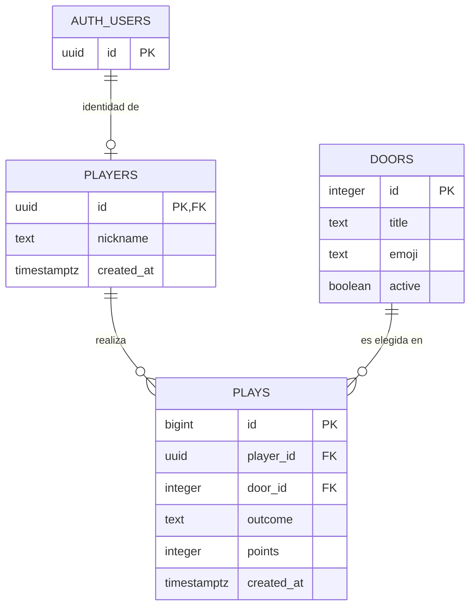

# 🎃 DULCE O TRUCO — Taller Full Stack de 4 horas

**Tecnologías:** PostgreSQL (en Supabase), Supabase Auth, Supabase Realtime, HTML, CSS, JavaScript y Cloudflare Pages.

**Meta:** cada equipo publica una web real donde un usuario escribe un apodo, abre hasta tres de seis casas de Halloween, recibe puntos aleatorios calculados **en PostgreSQL** y participa en un ranking en vivo.

## Estructura de los archivos

```text
taller_halloween_supabase/
├── README.md                      ← lee esto primero
├── GUIA_ALUMNOS.md                ← pasos y retos individuales/grupales
├── GUIA_DOCENTE.md                ← programa minuto a minuto y guion
├── RUBRICA_20_PUNTOS.md           ← evaluación
├── db/
│   ├── 01_esquema.sql             ← tablas, relaciones, seguridad, ranking y RPC
│   └── 02_practicas_sql.sql       ← 10 ejercicios y 2 retos
└── sitio/                         ← SOLO ESTA CARPETA se publica en Pages
    ├── index.html
    ├── styles.css
    ├── config.js                  ← aquí pegas TU URL y publishable key
    ├── app.js
    └── favicon.svg
```

## Inicio rápido (profesor y estudiantes)

1. Crea un proyecto en **https://supabase.com/dashboard**.
2. En **Authentication → Providers / Sign In / Anonymous**, **habilita Anonymous Sign-Ins**. La ubicación exacta puede variar según el dashboard.
3. Abre **SQL Editor → New query** y pega el contenido de `db/01_esquema.sql`. Haz clic en **Run**. Debe mostrar seis casas al final.
4. Abre **Project Settings → API** (o **API Keys** en el dashboard actual) y copia la **Project URL** y la **publishable key**. Una `anon` key pública de proyectos anteriores también funciona.
5. Abre `sitio/config.js`, reemplaza las dos cadenas vacías con tus valores. **NUNCA uses la secret key ni la service_role key en un sitio público.**

Ejemplo de configuración (valores ficticios):

```js
window.HALLOWEEN_CONFIG = {
  url: 'https://TU-PROYECTO.supabase.co',
  publishableKey: 'sb_publishable_TU_CLAVE_PUBLICA'
};
```

6. Abre una terminal en la carpeta raíz del taller y ejecuta:

```bash
python3 -m http.server 5500 --directory sitio
```

7. Abre **http://localhost:5500**. Ingresa un apodo, abre una casa y comprueba la fila creada en `public.plays` (Table Editor).
8. Abre otro navegador privado, ingresa con otro apodo y verifica el ranking. **Una ventana incógnita genera otro usuario anónimo**.
9. Ejecuta las consultas de `db/02_practicas_sql.sql` **una por una** en SQL Editor.
10. Para publicar, en Cloudflare **Workers & Pages → Create application → Drag and drop**, sube **solo la carpeta `sitio`** o crea un ZIP con su contenido. El archivo `index.html` debe estar en la raíz del contenido publicado.
11. Abre tu `https://NOMBRE.pages.dev`, juega de nuevo (el dominio publicado crea su propia sesión) y comparte el enlace.

Documentación oficial: [Supabase Auth anónima](https://supabase.com/docs/guides/auth/auth-anonymous), [RLS](https://supabase.com/docs/guides/database/postgres/row-level-security), [Realtime/Postgres Changes](https://supabase.com/docs/guides/realtime/postgres-changes), [Cloudflare Pages Direct Upload](https://developers.cloudflare.com/pages/get-started/direct-upload/).

## ¿Qué aprenderás?

- **Tabla**: colección de filas. Ejemplo: `doors` (casas).
- **Columna y tipo de dato**: `title text`, `id integer`, `created_at timestamptz`.
- **PRIMARY KEY**: identifica inequívocamente un registro.
- **FOREIGN KEY**: conecta una jugada con su jugador y su casa.
- **UNIQUE**: una persona no puede visitar la misma casa dos veces.
- **CHECK**: solo se admiten `dulce` o `truco` y sus puntos permitidos.
- **JOIN / GROUP BY / SUM**: une tablas y suma puntos para crear un ranking.
- **VIEW**: consulta reutilizable llamada `leaderboard`.
- **Auth**: cada jugador recibe un identificador UUID sin proporcionar correo.
- **RLS**: evita que los usuarios creen jugadas o modifiquen puntos directamente.
- **Función RPC**: lógica en PostgreSQL que valida turnos y asigna resultados aleatorios.
- **Realtime**: actualización del ranking mediante eventos de cambios en la BD.
- **Pages**: publicación estática de los archivos HTML, CSS y JS (el backend sigue en Supabase).

## Diagrama entidad-relación



`PLAYS` tiene además una restricción `UNIQUE(player_id, door_id)` para impedir dos visitas a la misma casa.

## Flujo de una visita

```text
Participante → JavaScript → Supabase Auth (sesión anónima)
          └→ players (apodo)
          └→ RPC play_door(door_id)
               → verifica usuario y casa
               → verifica máximo tres jugadas y no repetir casa
               → sortea dulce/truco y puntos en PostgreSQL
               → inserta una fila en plays
               → devuelve resultado al navegador
          └→ SELECT leaderboard (JOIN + GROUP BY)
          └→ evento Realtime → actualiza ranking de otros participantes
```

## Importante: seguridad y límites de la demostración

- El frontend **sí** contiene una clave publicable. Esto es normal. La **service_role** y cualquier **secret key** jamás deben exponerse.
- En esta versión el ranking es visible para participantes y muestra **apodos**, no correos ni nombres reales.
- La puntuación no puede alterarse pasando puntos desde el navegador: la decide la función SQL. No se permite `INSERT` directo en `plays`.
- Una persona puede crear otra identidad anónima desde otro navegador; **no es un sistema antifraude de premios reales**.
- Para publicar ampliamente conviene incorporar Turnstile/CAPTCHA, límites de tasa, controles contra abuso, moderación de apodos y limpieza de usuarios anónimos. Supabase también aplica límites propios de autenticación.
- En Supabase Realtime, Postgres Changes es simple para un aula pequeña; para aplicaciones de mayor escala conviene estudiar Broadcast.
- Esta plantilla está pensada para **aprendizaje**, no para dinero, apuestas ni premios con valor económico.

## Diagnóstico rápido

| Síntoma | Qué revisar |
|---|---|
| El botón «Entrar» está deshabilitado | `sitio/config.js` tiene URL y publishable key vacías o incorrectas. |
| Error al crear usuario anónimo | **Anonymous Sign-Ins** debe estar habilitado en Auth. |
| `relation "public.players" does not exist` | Ejecuta `01_esquema.sql` en el proyecto correcto. |
| `permission denied` o «new row violates RLS» | Ejecuta toda la sección de políticas del SQL. Comprueba que no uses otra base de datos. |
| Ranking no se actualiza solo | Revisa publicación `supabase_realtime`, WebSocket/red y recarga. El juego sigue funcionando aunque Realtime falle. |
| La web de Pages no muestra estilos | Sube `sitio` sin añadir otra carpeta encima; `index.html` debe estar en la raíz pública. |
| Al pasar de local a Pages «perdí mi usuario» | La sesión de Auth se guarda por origen/dominio. En Pages corresponde crear otra sesión. |

## Entregables

1. Captura de las tres tablas y sus relaciones en Supabase.
2. Capturas de al menos **tres consultas SQL** y explicación oral de un `JOIN`.
3. Web publicada en Cloudflare Pages con **URL comprobable**.
4. Evidencia de dos participantes y del ranking.
5. Una personalización funcional (séptima casa, mensajes, estilo, estadísticas o consulta SQL adicional).

Ver `GUIA_ALUMNOS.md` y `RUBRICA_20_PUNTOS.md` para la entrega evaluada.
